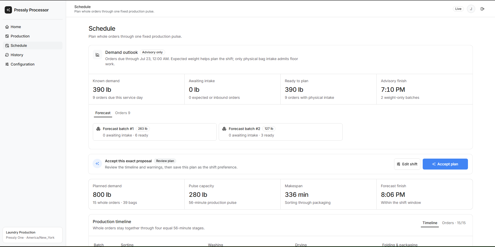
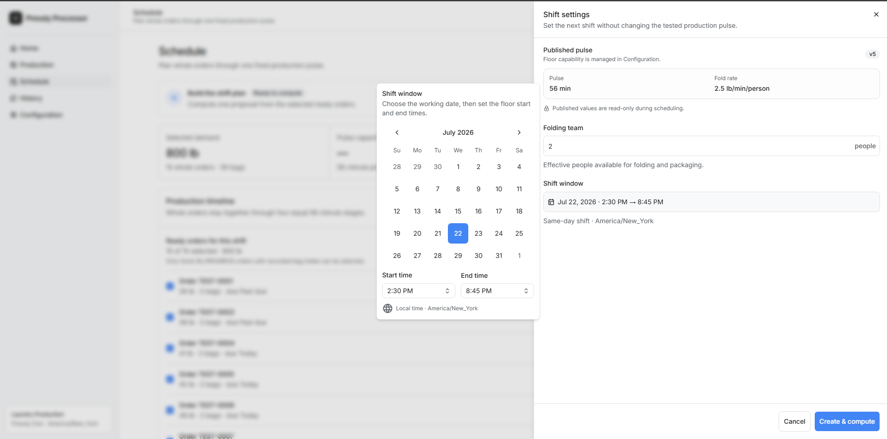
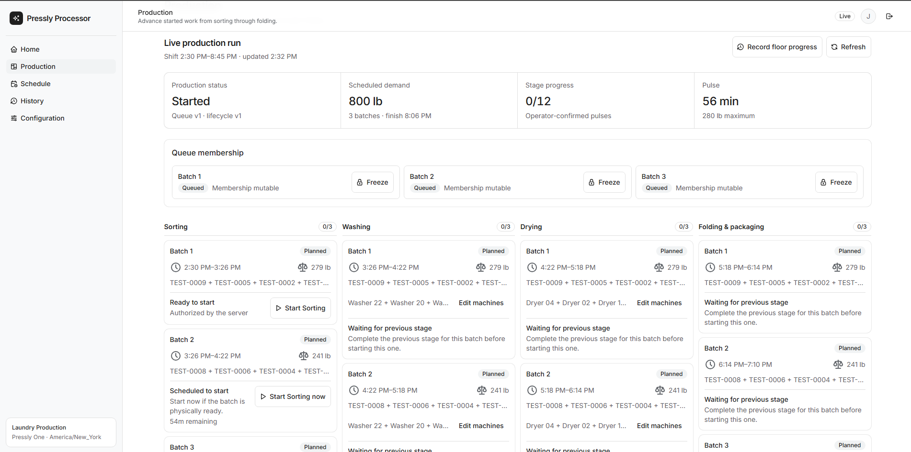

<div align="center">

# Pressly

**The operating layer between laundry orders and the production floor.**

Forecast demand. Build capacity-aware shifts. Keep every order together.
Run the floor from one live view.

</div>



Pressly Processor turns incoming laundry demand into an executable floor plan.
It connects Cents order events to physical intake, deterministic scheduling,
and operator-confirmed production—without treating software state as a
substitute for what is actually happening on the floor.

## Why it exists

An order system and a production floor answer different questions.

- The order system knows what was sold, promised, and communicated.
- The floor knows what physically arrived, what fits, and what is finished.

Pressly keeps those truths connected without collapsing them into one status.
Teams can plan from expected demand, admit work only after physical intake,
and confirm production progress as it happens.

## What it does

- **Turns Cents events into operational demand.** Orders, customers, services,
  due times, and lifecycle updates enter through an idempotent webhook path.
- **Forecasts before work reaches the floor.** Expected weight supports staffing
  and shift decisions while remaining clearly advisory.
- **Builds capacity-aware production plans.** Whole orders are leveled across
  sorting, washing, drying, and folding without splitting their bags.
- **Keeps operators in control.** Intake, shift selection, early starts,
  exceptions, rework, and completion require explicit floor decisions.
- **Runs from one live workspace.** Teams see the current queue, stage readiness,
  machine assignments, timing, and the next safe action.
- **Preserves source and floor truth.** Cents lifecycle changes can raise a
  comparison, but they never silently advance or finish physical production.

## Product tour

### Shape the shift around real capacity

Choose the operating window and folding team while the published production
pulse remains stable. Processor recomputes the plan from the selected orders
and the active washer, dryer, and folding constraints.



### Review the exact plan before committing

The schedule separates forecast demand from executable work, shows the selected
orders and bags, and explains the batches, makespan, and projected finish before
the plan is accepted.


### Advance production from the floor

Once a run starts, every batch moves through the same four-stage pulse. The live
board shows what can start now, what is waiting, and which machines are assigned
without inventing progress that an operator has not confirmed.



## From Cents event to clean order


The commercial order remains independent from its production fulfillment.
That boundary lets Pressly accept future order sources—and eventually other
fulfillment types—without making the floor engine Cents-specific.

## More than a clickable prototype

The product is backed by a working API, Worker, PostgreSQL model, and production
runtime. The implementation includes:

- canonical Users and Orders with exact external identity links;
- source-version ordering, idempotency, retries, and inspectable dead letters;
- immutable schedule revisions and server-authoritative start checks;
- optimistic concurrency around shift selection and live queue changes;
- operator-confirmed exception, rewash, and reconciliation workflows;
- English and Spanish Processor experiences; and
- automated architecture, contract, unit, integration, and deployment checks.

The core product rule is simple: **coordinate physical work without claiming
certainty the software does not have.**

## Run it locally

Prerequisites: Docker, Node.js 24, and pnpm 10.

```bash
corepack enable
pnpm install
pnpm docker:up
```

Then open:

- Processor: [http://localhost:4173](http://localhost:4173)
- API readiness: [http://localhost:4000/health/ready](http://localhost:4000/health/ready)
- Pressly web: [http://localhost:3000](http://localhost:3000)

Stop the stack with `pnpm docker:down`.

## Repository guide

- `apps/processor` — the production-floor application
- `apps/api` — HTTP delivery, authentication, and application composition
- `apps/worker` — durable webhook and fulfillment projection jobs
- `modules/business` — Users, Orders, Production, Pricing, and Auth capabilities
- `modules/computation` — deterministic scheduling and read projections
- `packages` — shared contracts, database schema, time, money, and runtime tools
- [`docs/architecture.md`](docs/architecture.md) — system boundaries and data flow

## Project status

Pressly is an independently built working product and an ongoing exploration of
how modern laundry software can connect commercial demand to reliable physical
execution. It is not affiliated with or endorsed by Cents.
